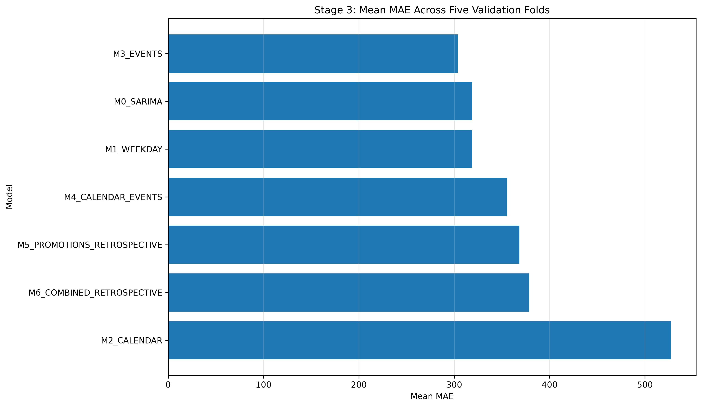
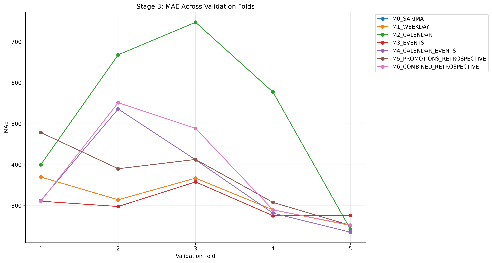

# Stage 3: Exogenous Feature Analysis

## 1. Objective

Stage 3 investigated whether additional calendar, event and
promotion information could improve the forecasting
performance of the Stage 2 SARIMA champion.

The selected SARIMA specification was held fixed:

SARIMA(1,1,1)(0,1,1,7)

The objective was to evaluate incremental feature value
without unnecessarily expanding the model search.

---

## 2. Experimental Design

Seven forecasting configurations were evaluated across five
expanding-window validation folds.

Each fold used a 30-day forecast horizon.

Configurations evaluated:

- M0_SARIMA: Baseline SARIMA
- M1_WEEKDAY: Weekday features
- M2_CALENDAR: Calendar features
- M3_EVENTS: Applicable event features
- M4_CALENDAR_EVENTS: Calendar and event features
- M5_PROMOTIONS_RETROSPECTIVE: Retrospective promotion features
- M6_COMBINED_RETROSPECTIVE: Combined retrospective features

Metrics included MAE, RMSE, forecast bias, fold performance,
convergence and fit diagnostics.

---

## 3. Model Ranking

Models were ranked by mean MAE.

|   rank | model                       |   successful_folds |   mean_mae |   median_mae |   std_mae |   mean_rmse |   mean_bias |   mae_improvement_pct |   rmse_improvement_pct |
|-------:|:----------------------------|-------------------:|-----------:|-------------:|----------:|------------:|------------:|----------------------:|-----------------------:|
|      1 | M3_EVENTS                   |                  5 |    303.676 |      297.921 |   33.865  |     423.589 |     74.7396 |                4.6865 |                17.5097 |
|      2 | M0_SARIMA                   |                  5 |    318.608 |      314.324 |   50.8169 |     513.502 |     56.2226 |                0      |                 0      |
|      3 | M1_WEEKDAY                  |                  5 |    318.616 |      314.327 |   50.8075 |     513.507 |     56.2222 |               -0.0028 |                -0.001  |
|      4 | M4_CALENDAR_EVENTS          |                  5 |    355.526 |      312.636 |  119.919  |     479.731 |    119.067  |              -11.5873 |                 6.5766 |
|      5 | M5_PROMOTIONS_RETROSPECTIVE |                  5 |    368.308 |      390.195 |   89.1932 |     531.163 |    -24.3547 |              -15.5993 |                -3.4394 |
|      6 | M6_COMBINED_RETROSPECTIVE   |                  5 |    378.642 |      310.818 |  132.62   |     505.997 |    135.083  |              -18.8428 |                 1.4615 |
|      7 | M2_CALENDAR                 |                  5 |    527.279 |      577.385 |  205.023  |     705.844 |      3.012  |              -65.4947 |               -37.4571 |

---

## 4. Leading Candidate: M3_EVENTS

The event-feature model achieved:

- Mean MAE: 303.6762
- Median MAE: 297.9205
- Mean RMSE: 423.5888
- Mean forecast bias: 74.7396
- Successful folds: 5

Compared with the baseline:

- MAE improvement: 4.69%
- RMSE improvement: 17.51%

The event-feature model produced the lowest mean MAE
among the evaluated configurations.

---

## 5. Fold-Level Robustness

The event model's fold-level performance is shown below.

|   fold |     mae |    rmse |   mae_improvement_pct |   rmse_improvement_pct |
|-------:|--------:|--------:|----------------------:|-----------------------:|
|      1 | 310.908 | 481.156 |               15.9621 |                25.9516 |
|      2 | 297.921 | 420.942 |                5.2185 |                22.2507 |
|      3 | 357.963 | 439.185 |                2.5266 |                17.4546 |
|      4 | 275.559 | 385.531 |                4.9291 |                16.2458 |
|      5 | 276.03  | 391.131 |               -9.6816 |                -1.8705 |

The event model recorded
4 MAE wins,
0 ties and
1 losses against
the baseline across five validation folds.

Mean fold-level MAE improvement:
3.79%.

Median fold-level MAE improvement:
4.93%.

Worst fold-level MAE improvement:
-9.68%.

Best fold-level MAE improvement:
15.96%.

---

## 6. Robustness Comparison Across Models

| model                       |   folds |   mae_wins |   mae_ties |   mae_losses |   mean_mae_improvement_pct |   median_mae_improvement_pct |   min_mae_improvement_pct |   max_mae_improvement_pct |   mean_rmse_improvement_pct |
|:----------------------------|--------:|-----------:|-----------:|-------------:|---------------------------:|-----------------------------:|--------------------------:|--------------------------:|----------------------------:|
| M3_EVENTS                   |       5 |          4 |          0 |            1 |                     3.7909 |                       4.9291 |                   -9.6816 |                   15.9621 |                     16.0064 |
| M0_SARIMA                   |       5 |          0 |          5 |            0 |                     0      |                       0      |                    0      |                    0      |                      0      |
| M1_WEEKDAY                  |       5 |          0 |          0 |            5 |                    -0.0033 |                      -0.001  |                   -0.0132 |                   -0.0002 |                     -0.0012 |
| M4_CALENDAR_EVENTS          |       5 |          3 |          0 |            2 |                   -11.5809 |                       2.7811 |                  -70.5499 |                   15.4952 |                      5.8882 |
| M5_PROMOTIONS_RETROSPECTIVE |       5 |          0 |          0 |            5 |                   -14.4552 |                     -12.4158 |                  -29.3711 |                   -0.0914 |                     -2.881  |
| M6_COMBINED_RETROSPECTIVE   |       5 |          2 |          0 |            3 |                   -18.5659 |                      -0.3414 |                  -75.4334 |                   15.9865 |                      1.029  |
| M2_CALENDAR                 |       5 |          1 |          0 |            4 |                   -64.0134 |                     -99.204  |                 -112.626  |                    3.5423 |                    -37.2007 |

---

## 7. Interpretation

### Event features

The M3_EVENTS configuration demonstrated the strongest
average forecasting performance among the evaluated
configurations.

It improved MAE in four of five validation folds.
However, it deteriorated in the fifth fold.

The results justify retaining the event configuration
as the leading experimental candidate, rather than
claiming universal superiority.

### Weekday features

Weekday features produced practically identical results
to the baseline.

The selected weekday specification therefore provided
little incremental forecasting value in this experiment.

### Calendar features

The calendar-only configuration was unstable across
validation folds.

Particularly severe deterioration occurred in folds
two, three and four.

Adding calendar variables did not automatically
improve forecasting performance.

### Promotions

The promotion experiment was retrospective because
observed promotion information was used in the
experimental setup.

Its results should not be interpreted as evidence of
operational forecasting performance unless future
promotional information is available and reliable
at forecast creation time.

### Combined features

Combined calendar and event configurations showed
mixed results.

Increasing the number of features did not guarantee
improved forecasting accuracy.

---

## 8. Limitations

- Only one store-product series was evaluated.
- Five validation folds were used.
- Each validation horizon contained 30 observations.
- Results may not generalize to other stores or products.
- Promotion experiments were retrospective.
- Event associations do not establish causality.
- Forecast accuracy improvements do not automatically
  translate into inventory or financial improvements.
- Feature availability at prediction time remains
  an operational requirement.

---

## 9. Stage 3 Decision

M3_EVENTS is retained as the leading experimental
forecasting configuration.

M0_SARIMA remains the baseline reference.

The observed improvement is promising, but further
validation is necessary before generalization.

Stage 3 is considered complete. Future forecasting
experimentation will be driven by inventory decision
requirements rather than indefinite model tuning.

---

## 10. Stage 4 Scope

Stage 4 will translate demand forecasting into
inventory decisions through:

1. Forecast uncertainty estimation.
2. Lead-time demand estimation.
3. Inventory position calculations.
4. Safety-stock estimation.
5. Reorder-point policies.
6. Service-level analysis.
7. Constrained replenishment optimization.
8. Inventory simulation and backtesting.

---

## 11. Figures

---

## Conclusion

Stage 3 demonstrated that additional features should
be evaluated empirically rather than assumed to improve
forecasting performance.

Applicable event features produced the strongest
average performance in this experiment, while
calendar and retrospective promotion configurations
showed mixed results.

The next stage focuses on transforming forecasts
into measurable inventory and replenishment decisions.
